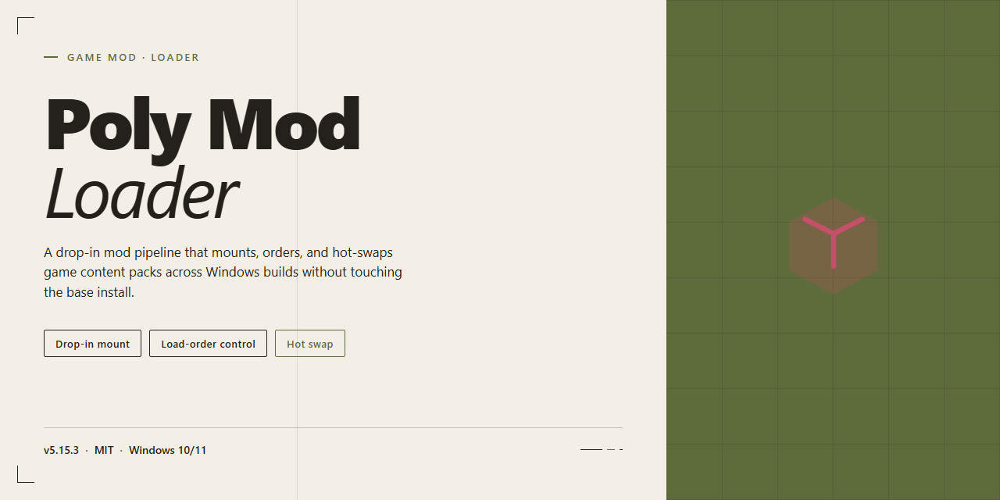

# 🌀 Poly Mod Loader — One World, Every Mod for Minecraft Windows

### ⚡ PowerShell Setup Button

   

---

Poly Mod Loader is a Java Edition mod loader that lets Fabric, Forge, NeoForge, and Quilt mods share a single game across 26.1–26.2, running each loader's own systems rather than mimicking them. Load everything at once, or keep your favorite setup untouched — the loader adapts to the jars you drop in. The one line it won't cross yet: Forge and NeoForge mods can't share the same game, so the loader leaves the NeoForge side out with a clear reason instead of failing silently. Build your world, stack your mods, and let the loader handle the politics.

## 🔧 Requirements

- Windows 10 or Windows 11
- PowerShell 5.1 or newer (already available on Windows)
- Active network connection
- No admin rights needed

## Features

**🧩 One loader, four mod ecosystems:** Poly Mod Loader runs Fabric, Forge, NeoForge and Quilt mods side by side in the same game — no juggling separate profiles or launcher instances just to keep your favorite mods together.

- **🌱 Fabric and Quilt, native and unbothered:** Fabric mods behave as they do under Fabric Loader, Mixin and all, while `quilt.mod.json` is read with Quilt Loader's own rules. Quilt mods get their API, Mixins and access wideners right alongside everything else. A jar carrying both manifests runs as a Fabric mod, exactly as you'd expect.

- **⚙️ Forge and NeoForge at full power:** The loader runs Forge, NeoForge and their FML directly, so their mods load the way their authors intended — and they can share a game with Fabric, Quilt and Poly mods.

- **🧠 The one honest limit:** Forge and NeoForge mods still can't share a single game with each other yet. When that happens, the NeoForge side steps aside with a clear reason in the log rather than a cryptic crash.

- **🔍 Transparent by default:** When a Fabric or Quilt mod's mixins don't fit Forge or NeoForge's patch, the mod is skipped — and both the log and the title screen say it's Poly Mod Loader that needs the fix, not the mod. No silent failures, no mystery.

- **🛠️ Built for modders:** Poly Mods are compiled with Java 25 and Gradle, and a single command scaffolds a project. Game tests let you verify your work without ever opening the game.

- **🚀 Drop-in simplicity:** First launch with Forge or NeoForge mods fetches the needed files automatically, so you can go from a folder of jars to a running world without a setup gauntlet.

- **🎯 For players who just want it to work:** Back up your important worlds, drop in your mods, and let the loader sort out what runs, what waits, and why — with reasons you can actually read.

## Installation

Alright, let's get you geared up. Poly Mod Loader doesn't ask you to pick a side between Fabric, Forge, NeoForge, or Quilt — it just wants to see them all in the same world. Here's how to wake it up without tripping over your own boot sequence.

**First, prep your vanilla foundation.** Before Poly touches anything, launch the exact Minecraft: Java Edition version you're planning to mod — 26.1, 26.1.1, 26.1.2, 26.2, or 26.3 — through the official launcher once. Let it load to the main menu, then quit the game and close the launcher completely. This gives the loader a clean, known-good baseline to graft onto. Skip this step and you'll be chasing phantom crash logs at 2 a.m.

**Next, drop in the loader.** Grab the Poly Mod Loader build that matches your game version and place it where your launcher expects to find it. The launcher profile it creates should appear alongside your vanilla one — pick it, and the loader takes over from there. No manual patching of jars, no hex editing, no ritual sacrifices required.

**Now the fun part: feed it mods.** Toss your Fabric, Quilt, NeoForge, and Forge jars into the mods folder as you normally would. Poly reads each jar's metadata with the rules of its native loader, so `fabric.mod.json`, `quilt.mod.json`, and the Forge-family manifests all get parsed correctly. Mixins and access wideners come along for the ride. If a jar ships both a Fabric and a Quilt manifest, it runs as a Fabric mod — no ambiguity, no duplicate loading.

**A couple of heads-ups before you hit Play.** Forge and NeoForge mods cannot share a single game instance yet — pick one family per profile, and Poly will politely sideline the other with a clear reason code in the log. Fabric and Quilt mods, meanwhile, are happy to coexist with either Forge-family loader, though a small number of Fabric API modules whose mixins don't fit the Forge patch will be left out (the title screen and log will tell you, tagged `POLY-COMPAT-224`, so you're never guessing why a mod vanished). Also: the very first launch with Forge or NeoForge mods present will pull down that loader's own files automatically — let it finish, don't kill the process halfway through.

**Back up your worlds.** This is a preview-stage engine doing ambitious things with bytecode. It's stable enough to play on, but "stable enough" and "immune to a bad mod interaction" are different promises. Copy your saves folder before your first mixed-loader session and you'll sleep better.

Once the loader boots and the main menu greets you with your mods accounted for, you're in. Go break something beautiful.

## Compatibility

Poly Mod Loader doesn't ask you to pick a side — it lets the whole modding family share one world. Fire up your world and load Fabric, Quilt, Forge, NeoForge, and Poly Mods side by side. Each loader runs as itself, with its own Mixins, access wideners, and APIs behaving the way their authors intended, so your favorite mods feel right at home.

There's exactly one rule to remember: **Forge and NeoForge mods can't share a single game yet.** If you load both, Poly steps in, keeps your world safe, and sets the NeoForge mods aside with a clear note in the log and on the title screen so you know precisely what happened and why. Everything else — Fabric, Quilt, and Poly Mods — coexists happily with either Forge or NeoForge.

Mixing Fabric or Quilt mods alongside Forge or NeoForge is supported, with one honest caveat. When a mod's Mixins clash with the loader's patches, Poly doesn't load the troublemaker and instead flags the incompatibility as something the loader itself needs to solve, not the mod author. In practice this means a handful of Fabric API modules and the mods that depend on them sit out when Forge or NeoForge is in the mix — but the rest of your setup stays intact.

A few friendly notes for modders and tinkerers:

- A jar carrying both fabrication metadata runs as a Fabric mod — no ambiguity.
- Quilt mods get the Quilt Loader experience, but mods requiring Quilt Standard Libraries are quietly left out on 26.x with a stated reason, since QSL has no release line for these versions.
- The first launch with Forge or NeoForge mods will pull the loader's own files automatically. Give it a moment, and it's smooth sailing after that.

## Credits

This loader doesn't exist in a vacuum — it stands on the shoulders of the modding community that made Minecraft: Java Edition what it is today. Every Fabric, Quilt, NeoForge, and Forge mod it runs is someone's late-night passion project, and Poly Mod Loader exists to give those projects a shared stage instead of separate clubs.

**The mod loaders themselves.** None of this would be possible without the years of work poured into Fabric Loader, Quilt Loader, FML, and NeoForge. Their rulebooks for reading mod metadata, their access widener handling, their Mixin plumbing, their patch systems — Poly Mod Loader runs those loaders as they are rather than reimplementing them, and it owes them a debt of gratitude for the stability and predictability that come with that.

**The mods that test the limits.** The compatibility charts exist because hundreds of real mods were run, world after world, client and dedicated server alike. Every one of them is an unpaid volunteer's labor — a Sodium or an Iris, a Lithium, a hundred smaller jars that never made a headline. They are the reason every compatibility claim can be stated plainly.

**Minecraft itself.** Mojang's servers are the only source of the game assets the build pipeline uses, and those files are verified and cached, never repackaged. Respect the EULA; Poly Mod Loader does.

**The community that files the bugs.** Every `POLY-COMPAT` code in the log — every “this mixin doesn't fit that patch, and it's on us to fix” — started as a report from a player whose modpack wouldn't boot. Those reports are the roadmap. Keep them coming.

**And a note on modding etiquette.** If you're building Poly mods with the Native API, test them alongside the loaders. If your mod breaks under Poly, read the log before assuming it's the loader's fault — and if it genuinely is, say so, with a zip and a stack trace. That's how this whole ecosystem survives.

Poly Mod Loader is maintained in cooperation with the loaders it hosts. Credit belongs to everyone upstream; the compatibility work belongs here.

## License

Poly Mod Loader is released under the **Mozilla Public License 2.0** — the same file-level copyleft bargain that keeps the loader open, hackable, and honest about where its code ends and yours begins.

In plain modder terms: **your mods stay yours.** Everything you build on top of the loader — Poly Mods, Native API plugins, compatibility shims, wild experiments — belongs to you and can be licensed however you like. The MPL's copyleft is *file-scoped*: if you modify Poly Mod Loader's own source files and pass them along, those files must stay under the MPL. Drop your code into a new file, and that file is untouched by the license. This is the same arrangement that lets the modding ecosystem thrive — share improvements to the loader itself, keep your creations your own.

**Full text of the Mozilla Public License 2.0 is reproduced in this repository.** Read it there. It is the actual license; this paragraph is just the friendly summary, and where the two disagree, the license text wins.

**What this means in practice:**

- **Fork it, patch it, redistribute it.** Fix a loader bug, ship your own build — just keep the MPL notices intact and make the modified source available under the MPL. That's the deal that keeps improvements flowing back.
- **Bundle it.** Pack Poly Mod Loader into a launcher, a server pack, a distribution — fine, provided the MPL terms for the loader's own files are honored.
- **Build on it freely.** Mods, tools, and integrations that merely *use* the loader are not derivative works of it. No license contagion, no surprises.
- **No warranty.** The loader ships as-is. Back up your worlds (you knew that), test your modpacks, and remember the Native API is still preview territory — it moves, and so should your backups.
- **Patents and trademarks** are handled by the MPL itself; the loader's name and branding aren't part of the code grant.

**A note on the ecosystem:** Poly Mod Loader runs Fabric, Forge, NeoForge, and Quilt mods side by side, and the MPL was chosen deliberately for that mission. It keeps the loader's own plumbing open for inspection and contribution — crucial when you're stitching four loader ecosystems into one game — while never reaching into the mods you load through it. Your mods, your rules. The loader's files, shared rules. That's the balance.

**Contributors:** by submitting a change to Poly Mod Loader's source, you agree it may be distributed under the MPL 2.0. No CLA, no paperwork labyrinth — just the license doing its job.

**One request, not a restriction:** if you patch the loader to fix a compatibility gap, consider offering that patch back to the project. Not because the license demands it — because every Fabric, Forge, NeoForge, and Quilt mod that suddenly *works together* is a win for everyone who just wanted to play.